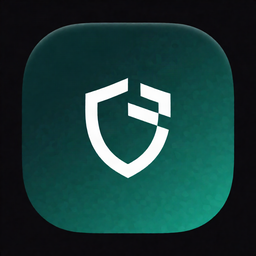

<div align="center">



# Rafiq

**رفيق ويندوز 10 و 11 — The Windows repair companion**

إصلاح مشاكل حقيقية: الشبكة، المساحة، الإعلانات، Copilot، والخدمات العالقة.  
بدون منظفات ريجستري وهمية، وبدون حساب، وبدون تتبع.

[تحميل ZIP + EXE](https://github.com/hamza756-pory/-/releases/tag/v1.0.0) · [الملف مباشرة](https://github.com/hamza756-pory/-/raw/arena/01a0e3ce-repo/dist/Rafiq-1.0.0-windows-x64.zip) · [تجربة الواجهة](https://htmlpreview.github.io/?https://github.com/hamza756-pory/-/blob/arena/01a0e3ce-repo/docs/app.html)

</div>

---

## لماذا هذا البرنامج؟

مستخدمو ويندوز 10 و 11 يواجهون نفس المشاكل يومياً، وحلول مايكروسوفت موزّعة بين الإعدادات وأوامر PowerShell المخفية:

| المشكلة | ماذا يفعل Rafiq |
| --- | --- |
| الواي فاي متصل والمواقع لا تُفتح | تفريغ DNS، تجديد IP، إعادة Winsock/TCP، تغيير DNS إلى Cloudflare / Google / AdGuard / Quad9 |
| القرص يمتلئ فجأة | فحص آمن للمؤقتات وذاكرة التحديثات وDelivery Optimization وسلة المحذوفات — مع عرض الحجم قبل الحذف |
| إعلانات شاشة القفل و Copilot و Widgets | درع خصوصية يطفئها من مفاتيح المستخدم |
| قائمة يمين ويندوز 11 بطبقتين | استرجاع القائمة الكلاسيكية |
| الصوت / الطابعة / Explorer / البحث | إعادة تشغيل الخدمة الصحيحة بضغطة |
| الجهاز بطيء بعد التشغيل | عرض برامج `Run` وتعطيلها |

الواجهة **عربية + إنجليزية** (RTL كامل). يعمل على ويندوز 10 (1809+) وويندوز 11.

## التحميل

1. نزّل [`Rafiq-1.0.0-windows-x64.zip`](https://github.com/hamza756-pory/-/releases/latest).
2. فك الضغط، ثم انقر `Rafiq.exe`.
3. إذا ظهرت نافذة SmartScreen: **المزيد من المعلومات → تشغيل على أي حال** (البرنامج مفتوح المصدر وغير موقّع بشهادة مدفوعة).
4. احتياطي: `RafiqUI.ps1` بزر أيمن → Run with PowerShell.

الملفات داخل الأرشيف:

```
Rafiq/Rafiq.exe       المشغّل
Rafiq/RafiqUI.ps1     المنطق + الواجهة (مفتوح)
Rafiq/README.txt
Rafiq/LICENSE.txt
```

## تجربة من أي جهاز

الواجهة تعمل في المتصفح (وضع عرض، بدون تعديل جهازك):

- [تجربة الواجهة في المتصفح](https://htmlpreview.github.io/?https://github.com/hamza756-pory/-/blob/arena/01a0e3ce-repo/docs/app.html)
- [صفحة المنتج](https://htmlpreview.github.io/?https://github.com/hamza756-pory/-/blob/arena/01a0e3ce-repo/docs/index.html)
- المصدر: [`docs/app.html`](docs/app.html)

## الأمان

- يستمع فقط على `http://127.0.0.1` (هذا الجهاز).
- لا يرسل بيانات إلى الإنترنت (تغيير DNS اختياري محلي على المحوّل).
- لا يوجد منظف ريجستري، لا يوجد “تسريع 200٪”.
- أوامر مثل إعادة Winsock تحتاج مسؤولاً ثم إعادة تشغيل.
- التنظيف يحذف مسارات معروفة فقط (`%TEMP%`، كاش التحديثات، …) وليس المستندات.

## البناء من المصدر

لا تحتاج مترجم C. بايثون 3 يكفي لتوليد الـ EXE:

```bash
python3 tools/build.py
```

ينتج `dist/Rafiq.exe` و `dist/Rafiq-1.0.0-windows-x64.zip`.

`Rafiq.exe` هو مشغّل Windows x64 صغير يستخرج السكربت إلى `%TEMP%\Rafiq` ويشغّل Windows PowerShell، ثم تفتح الواجهة في Microsoft Edge كنافذة تطبيق (`--app`).

## الرخصة

[MIT](LICENSE)

---

## English

Rafiq is a bilingual (Arabic / English) companion for **Windows 10 and Windows 11**. It targets problems people actually search for: DNS that dies while Wi-Fi is “connected”, disks eaten by update caches, lock-screen ads, Copilot/Widgets clutter, and the usual frozen services (Explorer, audio, print spooler, Search).

It is **not** a registry cleaner and it does **not** phone home. The live UI is served on localhost only.

### Quick start

1. Download the ZIP from [Releases](https://github.com/hamza756-pory/-/releases/latest).
2. Run `Rafiq.exe`.
3. If SmartScreen blocks it, choose **More info → Run anyway** (unsigned open-source build).
4. Fallback: right-click `RafiqUI.ps1` → Run with PowerShell.

Try the interface on a phone or Mac in demo mode via GitHub Pages (`docs/app.html`).
